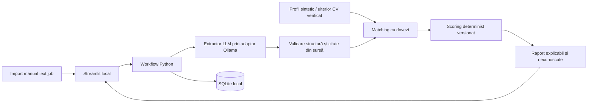

# Arhitectură MVP — propunere

Sunt implementate stocarea, validatorii, scoring-ul, eligibilitatea, fluxul AI local și UI Streamlit în `app.py`. `jobhunter/ui_session.py` separă starea sesiunii de logica de domeniu. Workflow-ul AI produce drafturi; numai confirmarea explicită poate aplica o decizie cu audit. Profilul poate fi fictiv sau master revizuit, dar niciun CV real nu a fost încă furnizat/validat.

`cv_import.py` extrage local documentul în blocuri cu poziții; `master_profile.py` construiește excerpts trasabile, versiuni și înregistrarea revizuirii. `profile_ui.py` gestionează importul/confirmarea. Fișierul original și textul integral sunt stocate în `master_documents`; snapshoturile profilurilor sunt în `master_profiles`. `validate_profile()` acceptă proveniența opțională fără a modifica profilele vechi. Metadatele de audit și bytes-ul CV-ului nu intră în promptul de matching.

Pentru limbile adnotate explicit, `jobhunter/languages.py` înlocuiește propunerea LLM cu un rezultat calculat în cod, păstrând originalul. Limbile, nivelurile, condițiile și dovezile devin parte a snapshotului aprobat; nu sunt o extragere automată sau o dovadă de adevăr semantic. Lipsa unei asocieri produce unknown. Celelalte competențe rămân pe fluxul LLM cu revizuire.

## Separarea responsabilităților

- UI: import text, revizuirea cerințelor și raport; preferințe configurabile. Streamlit reduce efortul frontend pentru un singur utilizator. Un frontend separat și FastAPI devin utile pentru multi-user sau integrare externă, cu cost de mentenanță mai mare.
- Servicii Python: orchestrare fixă, validare, deduplicare, scoring și exporturi ulterioare; logică independentă de UI pentru testare.
- LLM: propune cerințe structurate și posibile corespondențe cu dovezi. Nu stabilește singur compatibilitatea și nu execută acțiuni externe. JSON valid nu garantează adevărul; citatele și atribuirea trebuie verificate separat.
- SQLite: joburi, profiluri versionate, cerințe, evaluări, rubrică, stare și audit. Fișier local simplu; limitările de concurență sunt acceptabile pentru MVP personal.
- Adaptor de model: permite ulterior compararea local/cloud fără rescrierea scorului. Cloud rămâne dezactivat până la aprobare și buget.

## Scoring implementat pentru experimentul inițial

Cerințe obligatorii cu greutate 2, opționale cu greutate 1; ponderile sunt parametrizabile în Python și incluse în raport cu versiunea rubricii. Cerințele cu prioritate unknown sunt excluse explicit, cu avertizare, fără greutate presupusă. Stări: susținută de dovezi, parțială, lipsă confirmată, necunoscută. Necunoscutul rămâne vizibil, fără a afirma că utilizatorul nu deține competența.

Contribuții: 1 pentru susținută, 0,5 pentru parțială, 0 pentru lipsă confirmată. Pentru matching necunoscut raportăm un interval: scor minim cu contribuție 0, scor maxim cu contribuție 1, împărțite la suma ponderilor incluse. Separat, acoperirea este ponderea cerințelor evaluate / ponderea inclusă. Fără cerințe cu prioritate cunoscută: scor indisponibil. O condiție obligatorie parțială, lipsă sau necunoscută produce avertizare explicită, indiferent de medie. Nu prezentăm scorul drept probabilitate de angajare. Rubrica necesită calibrare pe exemple etichetate uman. Detalii și limite în [SCORING.md](SCORING.md).

Compatibilitatea profesională și prioritizarea după locație, limbă, hands-on și salariu sunt separate. Salariul absent este necunoscut; brutul nu se compară direct cu reperul de 3000 EUR net. Remote Europe nu garantează eligibilitate din România.

## Limite și extensii

Fără RAG în MVP: un CV și un job încap inițial în context, sub rezerva măsurării tokenilor. Fără agenți: pașii sunt cunoscuți și controlabili. Importul manual permite valoare înaintea integrării surselor. Discovery va folosi doar surse permise verificate individual.

Separăm datele private de Git, evităm conținutul CV în loguri și tratăm joburile ca date neîncredere. Expunerea UI va fi locală. Politicile detaliate de securitate și confidențialitate vor fi dezvoltate odată cu stocarea datelor reale.
