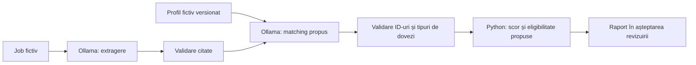

# Matching local și raport provizoriu

## Flux implementat



Rulare, din proiect:

```powershell
.\.venv\Scripts\python.exe -m jobhunter.analyze_demo
```

Demo-ul citește doar jobul și profilul fictive din `tests/fixtures/`. Face două apeluri locale secvențiale, fără tools, la modelul deja instalat. Afișează JSON și nu modifică SQLite. Timeoutul este per apel, nu pentru întregul flux. Nu descarcă modele, nu apelează cloud și nu trimite aplicații.

`jobhunter/ai_matching.py` transmite cerințele și faptele de profil ca date, cerând status, ID-uri de dovezi și explicații în română. Python adaugă versiunile, verifică acoperirea tuturor cerințelor, ID-urile și tipul dovezilor. O lipsă confirmată trebuie să citeze un fapt `confirmed_gap`; informația absentă rămâne `unknown`. Intrările prea mari sunt respinse fără trunchiere, iar lista goală de cerințe nu consumă un apel suplimentar de matching.

`jobhunter/analysis.py` revalidează rezultatele, calculează scorul și construiește o propunere de eligibilitate. Rezultatul este un `AnalysisDraft`, cu `review_status: pending_semantic_review` și `decision_applied: false`. Chiar dacă politica propune rejected, acest workflow nu aplică respingerea și nu apelează repository-ul. Motorul de eligibilitate anterior rămâne destinat datelor revizuite. Nu există încă interfață/acțiune de aprobare sau audit al unui reviewer; simplul indicator pending nu reprezintă validare umană.

API-ul local și formatul cu schemă urmează [documentația Ollama chat](https://docs.ollama.com/api/chat) și [structured outputs](https://docs.ollama.com/capabilities/structured-outputs), consultate la implementare. Transportul local limitat, verificările de finalizare și erorile sunt reutilizate din adaptorul de extragere.

## Prima rulare observată

Raportul real este păstrat în `docs/evaluations/ollama_analysis_001_run_001.json`:

- Extragere: 2,817 secunde, 396 prompt tokens, 102 tokens generați.
- Matching: 4,870 secunde, 692 prompt tokens, 318 tokens generați.
- Patru din patru statusuri și seturi de ID-uri de dovezi coincid cu referința agentului; comparația nu evaluează explicațiile și nu certifică semantica.
- Scor provizoriu 60% pe cele trei cerințe cu prioritate cunoscută. Prioritatea furnizorilor rămâne necunoscută și exclusă din scor.
- Eligibilitate propusă needs_review: engleză parțial susținută și prioritate necunoscută pentru furnizori. Nicio decizie aplicată.

Am identificat o eroare chiar în această rulare: explicația despre engleză folosește expresia nefirească „profesionistul de calitate” și spune că persoana este în curs de înscriere la cursuri, deși profilul spune că participă deja. Nu am corectat tacit outputul modelului în raport. Statusul partial și ID-ul P2 sunt corecte față de exemplul propus, dar explicația nu este fidelă integral.

Cele 60 de teste locale au trecut, cu transport simulat pentru inference. Rularea reală este separată. Nu comparăm direct aceste latențe cu prima rulare de 37,449 secunde: nu am controlat încărcarea, cache-ul sau utilizarea GPU. Nu este benchmark reprezentativ și nu s-au folosit date personale.

## Pasul următor

Un raport lizibil pentru revizuire, cu citatul jobului și textul exact al dovezilor afișate împreună, înainte de aprobarea sau corectarea propunerilor. Apoi cazuri suplimentare pentru limbi obligatorii/opționale/alternative și explicații fidele. Ajustarea promptului sau a modelului trebuie evaluată față de exemple, nu declarată îmbunătățire doar fiindcă produce JSON valid.
